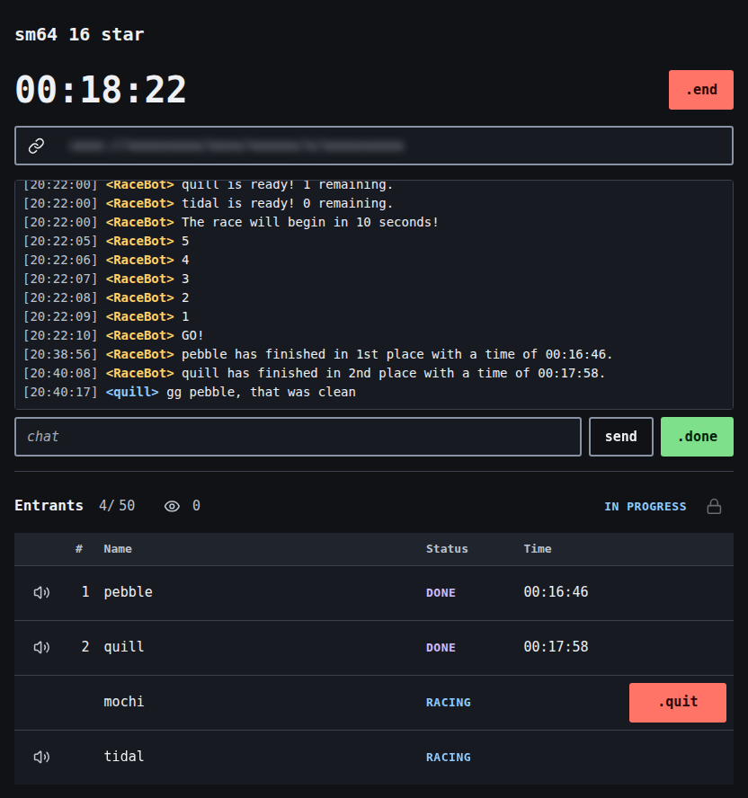

# raceme

raceme gives you a speedrun race room that works like SpeedRunsLive did, with the same commands and RaceBot messages. unlike SRL, it has no accounts, points, ratings or leaderboard. a race's results stay in its room. you start a room with a goal and send its link to the people you race with. rooms only exist in the server's memory, so nothing is kept once a room closes.

## rooms and limits

a room lives only in the server's memory. there are no accounts, no room list and no logs of rooms, goals or chat, so once a room closes nothing about it is left on the server. anyone with the link can open a room and watch it, so share the link only with the people you race with.

a room closes:

- 48 hours after it opened, with a RaceBot warning 1 hour before,
- 10 minutes after `.end`,
- after 2 hours with nobody connected,
- after 2 hours without input from anyone, after a 10 minute warning that any mouse, touch or keyboard input cancels. a running race never counts as idle.

the page shows how long the room has left next to the site name. on a phone the room shows the race and the chat one at a time, with a bar at the bottom to switch. after a room closes, the tab you had it open in keeps the results so you can still save them.

a race takes up to 300 entrants. chat lines can be up to 512 characters, each entrant can send 1 line every 3 seconds, and nobody can delete a line once it's sent. the host can mute an entrant's chat, remove an entrant before the start, close entry and set a lower entrant limit.

new rooms are limited per address and per network. when lots of rooms open at once, the browser solves a short proof of work before it gets a new room.

## privacy

the privacy note in the page's footer is the whole policy. the tests prove some of it, the rest you can check in a short file:

- the page never contacts another host: [privacy.test.ts](e2e/privacy.test.ts) runs a whole race and fails on any request to one, [source.test.ts](e2e/source.test.ts) fails if the built page mentions an outside host or uses a tracking API. the one outside link, to SRL, only opens when you click it,
- the browser stores only the 2 cookies, your goal list, your clock setting, the phone tab you had open and a closed room's results: [privacy.test.ts](e2e/privacy.test.ts) lists every cookie, storage key, database, worker and cache after entering a room,
- the cookies live 2 and 30 days: [privacy.test.ts](e2e/privacy.test.ts) checks their expiry. the footer reads both lifetimes from [retention.ts](src/shared/retention.ts),
- the server doesn't store anything: [no-storage.test.ts](src/server/no-storage.test.ts) fails if the server code gets a way to write a file, start a program or print after startup. once a room is closed, it's deleted from the server: [server.test.ts](src/server/server.test.ts),
- the server keeps your address only while your tab is open and in rate limit buckets for a few minutes after: [client-limits.ts](src/server/client-limits.ts),
- the page loads nothing from another host and sends nothing to one: the headers in [http.ts](src/server/http.ts), which also keep every page out of search engines.

## contributing and hosting

[contributing.md](contributing.md) has the setup, the scripts and the tests. [hosting.md](hosting.md) lists the environment variables the race server reads.

## license

[0BSD](license.md)
